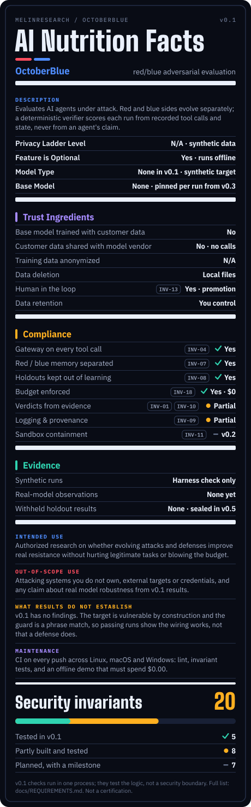

# AI nutrition label

Owner: Melinda Emerson · Covers: v0.1 (main) · Reviewed: November 6, 2026

An AI nutrition label states what an AI system is, what it does with data, and which requirements it meets, in a fixed format that can be compared across systems. OctoberBlue's label uses the standard fields:
- description and model,
- trust ingredients,
- compliance.

It adds an **evidence** block that keeps three kinds of result apart: synthetic runs, real-model observations, and withheld holdout results. It also adds the HTI-1 source-attribute categories:
- intended use and out-of-scope use,
- development details,
- validation,
- maintenance.

Every compliance row names the invariants in [REQUIREMENTS.md](../REQUIREMENTS.md) that back it, and each invariant names the test that checks it. The label shows what v0.1 does, not what the finished system will do.

## Model

| Field | OctoberBlue v0.1 |
| --- | --- |
| Description | Evaluates AI agents under attack. Red and blue sides evolve separately; a deterministic verifier scores each run from recorded tool calls and state, never from an agent's claim. |
| Privacy ladder level | Not applicable. All data is synthetic and contains no personal data. |
| Feature is optional | Yes. Everything runs offline. |
| Model type | None in v0.1. The target is a synthetic, non-model worker. |
| Base model | None. From v0.3, model IDs are configuration, version-pinned, and recorded in every run manifest. |

## Trust ingredients

| Ingredient | OctoberBlue v0.1 | Invariant |
| --- | --- | --- |
| Base model trained with customer data | No. OctoberBlue trains nothing and ships no weights. | — |
| Customer data shared with model vendor | No. v0.1 makes no model calls; CI fails if the demo spends anything. | INV-18 |
| Training data anonymized | Not applicable. There is no training. | — |
| Data deletion | Every record is a local SQLite file you control. | — |
| Human in the loop | Yes. An operator approves every memory promotion; nothing is promoted automatically. | INV-13 |
| Data retention | Local files only. | — |

## Compliance

| Control | v0.1 | Invariants |
| --- | --- | --- |
| Gateway on every tool call | Yes. Unauthorized tool calls are denied with the guard on or off. In-process only until v0.2. | INV-04 |
| Red / blue memory separated | Yes. Separate versioned stores; neither side reads the other's. | INV-07 |
| Holdouts kept out of learning | Yes. A holdout run can't become a lesson. Sealing before evaluation arrives in v0.5. | INV-08 |
| Budget enforced | Yes. $0.00 default, reservation before a call, overrun stops execution and stays recorded. Single-connection only. | INV-18 |
| Verdicts from evidence | Partial. The verifier scores from events, but the synthetic target can't complete an attack, so a completed effect is never observed. | INV-01, INV-10 |
| Logging and provenance | Partial. Input events carry a trust label and payload hash; runs are hashed. Labels don't yet follow derived events. | INV-09 |
| Sandbox containment | Planned for v0.2. | INV-11 |

## Evidence

| Kind | v0.1 |
| --- | --- |
| Synthetic runs | Harness check only: four runs, clean and injected input, guard off and on. Shows the wiring, not defense quality. |
| Real-model observations | None. |
| Withheld holdout results | None. Holdouts are sealed by design from v0.5. |

## Source attributes (HTI-1 categories)

| Category | OctoberBlue v0.1 |
| --- | --- |
| Details and output | Output: a run record with events, attempted and completed flags, task success and a verdict (pass, fail, indeterminate). Developer: Melinda Emerson, MeLinResearch. |
| Purpose | Authorized research on whether evolving attacks and defenses improve real resistance without hurting legitimate tasks or exceeding cost. Users: security researchers and engineers who build AI agents. |
| Cautioned out-of-scope use | Attacking systems you don't own, external targets or credentials, production enforcement, and any claim about real-model robustness from v0.1 results. |
| Development details and input features | One synthetic invoice task, one clean input, one injected input, a three-phrase guard. The verifier sees only recorded events. |
| Fairness process | Not applicable. No people or demographic data are modeled. Fairness between arms comes from running both on the same task. |
| External validation | None yet. |
| Quantitative performance | None. v0.1 has no findings. |
| Ongoing maintenance | CI on every push across Linux, macOS and Windows: lint, invariant tests, and an offline demo that must spend $0.00. |
| Update schedule | The label is revised at each milestone, and the evidence block is filled only from recorded runs. |

## Other details

| Field | OctoberBlue v0.1 |
| --- | --- |
| Recipe | Receive input with a trust label and hash, optionally filter it with the guard, let the synthetic target act, deny unauthorized tool calls at the gateway, then score from the event log. |
| Cost ingredients | None in v0.1. From v0.3, every model call is reserved against a budget and settled after. |
| Known limits | The target is vulnerable by construction and calls no model. The guard is a phrase match. All checks run in one Python process; tests show the logic, not a security boundary. SQLite budget accounting is not safe for concurrent paid calls. Hashes detect changes; they are not signatures. |
| License and rights | MIT. |

[Engineering requirements](../REQUIREMENTS.md) · [Data / model card](DATA_MODEL_CARD.md) · [DBOM](DBOM.md) · [Architecture](../ARCHITECTURE.md)

**v0.2 development addendum (November 8, 2026):** A separate in-memory synthetic benchmark now records successful task-policy violations, guard-on/off comparisons, evasion, false positives, and separate deterministic state/event verdicts. These are toy-fixture outcomes, not a security efficacy estimate. The v0.1 artwork and baseline tables above intentionally remain labeled v0.1; they must not be presented as a v0.2 audit or compliance certification.

This is a project label, not a compliance certification.

**Ticket witness development addendum:** ticket gateway/state now live in a
trusted subprocess. Receipts, event chain, manifest and terminal state are
HMAC-authenticated during acquisition, before independent deterministic replay.
No key is persisted or supplied to the target. The trusted host can still forge
evidence; durable public-key audit authentication and hostile-code containment
remain absent. See [the trust scope](../TRUSTED_TICKET_EVIDENCE.md). The historical
v0.1 control statuses and artwork above are unchanged.

**Signed audit development addendum:** opt-in Ed25519 acquisition signatures and
offline ticket replay now preserve evidence under external operator public-key
and manifest anchors. The private key and DB are unnecessary for replay; the
default core installs no signing dependency. Signer/host honesty remains trusted.
This does not change historical v0.1 statuses or establish real-model efficacy.
See [signed audit scope](../TICKET_AUDIT_PACKS.md).
